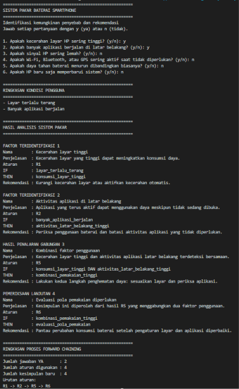
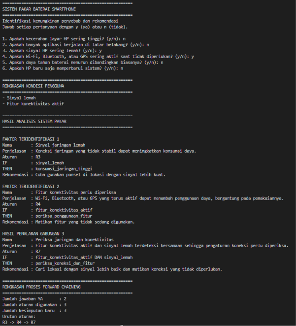
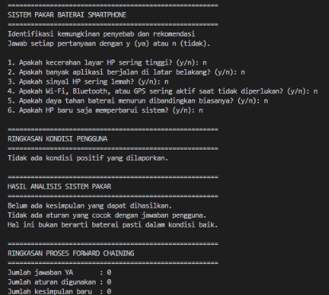

# Sistem Pakar Identifikasi Penyebab Baterai Smartphone Cepat Habis

- **Nama:** Bunga Salma Azzahrah
- **NIM:** F1D02410110
- **Mata Kuliah:** Kecerdasan Buatan
- **Metode:** Forward Chaining

## 1. Topik

Mengidentifikasi kemungkinan faktor penyebab baterai smartphone cepat habis berdasarkan kondisi yang dilaporkan oleh pengguna dengan memperoleh melalui pertanyaan mengenai kecerahan layar, aplikasi yang berjalan di latar belakang, kekuatan sinyal, fitur konektivitas, penurunan daya tahan baterai, dan pembaruan sistem.

## 2. Cara Menjalankan Program

### Bahasa

- Python 3

### Langkah menjalankan

1. Clone repository dari GitHub atau buka folder repository di Visual Studio Code.
2. Buka terminal pada folder proyek.
3. Run code
4. Jawab pertanyaan yang ditampilkan menggunakan `y` untuk ya atau `n` untuk tidak.
5. Baca hasil analisis, alasan penarikan kesimpulan, rekomendasi, dan keterbatasan sistem.

## 3. Sumber Pengetahuan

### Sumber 1 — Samsung Indonesia

Judul: Tips untuk memaksimalkan baterai ponsel Galaxy Anda.

URL: https://www.samsung.com/id/support/mobile-devices/tips-to-make-the-most-out-of-your-galaxy-phones-battery/

Tanggal akses: 13 November 2026.

### Sumber 2 — Xiaomi Indonesia

Judul: Apa yang harus dilakukan jika ponsel cepat menguras baterai?

URL: https://www.mi.co.id/id/support/faq/details/KA-285271/

Tanggal akses: 13 November 2026

## 4. Basis Aturan

- R1 menyimpulkan bahwa konsumsi daya layar mungkin tinggi jika kecerahan layar sering tinggi.

- R2 menyimpulkan bahwa aktivitas aplikasi di latar belakang mungkin tinggi jika banyak aplikasi berjalan.

- R3 menyimpulkan bahwa konsumsi daya terkait jaringan perlu diperhatikan ketika sinyal lemah.

- R4 menghasilkan kesimpulan untuk memeriksa penggunaan fitur konektivitas yang tidak diperlukan.

- R5 menggabungkan hasil R1 dan R2 untuk mengidentifikasi kombinasi faktor penggunaan.

- R6 menggunakan hasil R5 untuk menghasilkan kesimpulan lanjutan mengenai evaluasi pola pemakaian.

- R7 menggabungkan fakta sinyal lemah dan fitur konektivitas aktif untuk menyarankan pemeriksaan jaringan dan konektivitas.

- R8 menyarankan pemeriksaan kondisi baterai ketika daya tahannya menurun dibandingkan biasanya.

- R9 menghasilkan kesimpulan mengenai kemungkinan konsumsi daya sementara setelah pembaruan sistem.

## 5. Metode 

Sistem menggunakan metode Forward Chaining, yaitu metode penalaran yang dimulai dari fakta awal dan bergerak menuju kesimpulan berdasarkan aturan yang terpenuhi.

Tahapan proses:

1. Mengumpulkan fakta dari jawaban pengguna.
2. Memeriksa kondisi setiap aturan.
3. Jika seluruh kondisi suatu aturan terpenuhi, hasil THEN ditambahkan sebagai fakta baru.
4. Memeriksa kembali aturan menggunakan fakta baru tersebut.
5. Mengulangi proses sampai tidak ditemukan kesimpulan baru.
6. Menampilkan hasil beserta alasan dan rekomendasi.

## 6. Screenshot

### Dokumentasi Pengujian

#### Pengujian 1 — Kombinasi faktor penggunaan

#### Pengujian 2 — Gangguan jaringan dan konektivitas

#### Pengujian 3 — Tidak ada kesimpulan

## 7. Keterbatasan Sistem

Sistem ini menggunakan aturan IF–THEN yang telah ditentukan dan bergantung pada jawaban pengguna. Program tidak membaca data kesehatan baterai, suhu, atau penggunaan daya perangkat secara langsung. Faktor yang belum tercakup dalam basis aturan tidak dapat diidentifikasi. Oleh karena itu, hasil analisis hanya menunjukkan kemungkinan penyebab berdasarkan pengetahuan yang tersedia dan tidak dapat dianggap sebagai diagnosis pasti. Rekomendasi juga perlu disesuaikan dengan model smartphone dan kondisi pengguna.

## 8. Penggunaan AI

AI digunakan sebagai alat bantu untuk memahami konsep Forward Chaining, menyusun rancangan aturan, membantu pengembangan kode Python.

